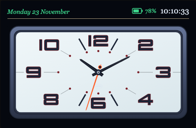
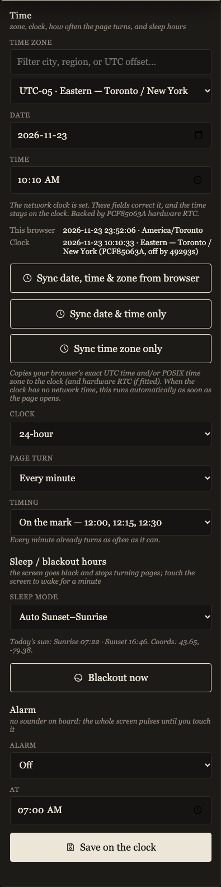
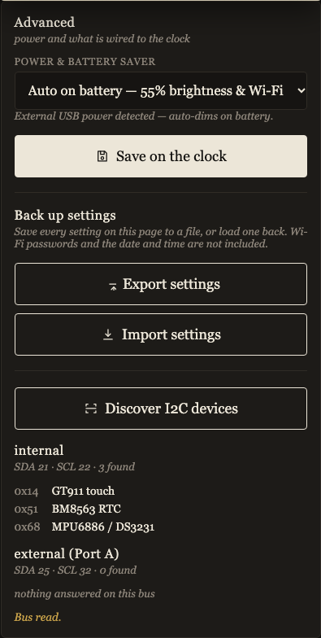

# Literature Clock

A touchscreen desk and wall clock that tells the time with a line from a book — styled to read like warm or dark paper, with serif typography, accented time phrases, and **3,461 family-friendly literary quotes** built directly into firmware flash (**no cloud account and no SD card needed**).

This public repository hosts the **user documentation** and **compiled OTA firmware releases** (no source code) checked by clocks via the Web UI **Update** tab and optional **daily 03:00 AM** auto-update check.

---

## Documentation

- **[User Manual](docs/USER-MANUAL.md)** ([printable PDF](docs/USER-MANUAL.pdf)) — Setup guide, live phone-width screenshots for all 12 tabs, touch gestures map, and factory defaults.
- **[Features & Technical Reference](docs/FEATURES.md)** — Full screen-by-screen behaviour, Web API, Serial CLI commands, NVS settings, and hardware notes.

### Web UI screenshots

| Quote page | Square retro dial | Time, zones &amp; sleep | Power, battery &amp; I2C |
|---|---|---|---|
|  |  |  |  |

See **[all 12 tab screenshots &amp; the swipe-gesture diagram](docs/USER-MANUAL.md#4-settings-tabs-screenshots)** in the user manual.

---

## Key Features

- **Offline literary library in flash:** 3,461 family-friendly quotes across 1,409 unique minutes built into the firmware binary. Tap the clock to turn the page immediately or choose 1 / 5 / 15 / 30 / 60-minute intervals.
- **Hardware RTC first + one-shot NTP + battery saver:** Supports onboard **PCF85063A** (Waveshare 4.3B), **BM8563** (M5Paper), and external **PCF85063A / DS3231** RTCs. Verifies time via NTP **once** on start-up or Wi-Fi connect and stops SNTP, backed by browser time/timezone sync and 4 power modes (*Always on*, *Sleep Wi-Fi when idle*, *Auto on battery*, and *Battery saver always*).
- **Battery indicator icon:** Automatically displays charge level in the clock header and phone UI when **M5Power** PMIC, I2C **INA219** (`0x40`), or an ADC divider is present.
- **Eight clock faces &amp; 90° screen rotation:** Quote page, Classic, 1950 rectangle, Flip (4 or 6 individual digit cards), Digital, Split, **Square (1970s retro)** (`clockFace=7`, smooth AA + full-screen Zen), and **Nixie tube** (`clockFace=8`), with `0°` / `90°` / `180°` / `270°` orientation support across portrait (`480×800`) and landscape (`800×480`).
- **Twelve paper palettes, Auto-Night &amp; Blackout Sleep:** Supports `Off`, `Auto 21:00–06:00`, **Auto Sunset–Sunrise** (solar calculation from Weather or manual coordinates), `Always dark`, scheduled blackout sleep, and instant **Blackout now**.
- **Phone Web UI, Setup Wizard &amp; Touch Gestures:** Guided 4-step **First-time setup wizard** after factory reset (on-device touchscreen wizard on Waveshare panels + Phone Web UI wizard across all boards), full 12-tab browser interface at `http://literature-clock.local/` (with optional WPA2 password for `LiteratureClock`, factory reset, and settings export/import), on-device &amp; Serial greeting editor, plus capacitive swipes and long-press Zen mode on 7″ and 4.3B panels.

---

## Supported Hardware

| Board SKU | Environment Slug | Notes |
|---|---|---|
| **Waveshare ESP32-S3-Touch-LCD-7** | `waveshare-lcd7` | 7″ 800×480 RGB, GT911 touch, CH422G — flash/serial via **UART** or native **USB** (`USB_CDC_ON_BOOT=1`) |
| **Waveshare ESP32-S3-Touch-LCD-4.3B** | `waveshare-lcd43` | 4.3″ 800×480 RGB, GT911 touch, CH422G, onboard **PCF85063A RTC** — flash via native USB-C port |
| **M5Paper** | `m5paper` | 4.7″ e-ink, onboard `BM8563` RTC &amp; `M5Power` PMIC |
| **ESP32-2432S028R (CYD)** | `cyd-28` | 2.8″ 240×320 SPI TFT + XPT2046 resistive touch |

---

## Prebuilt OTA Firmware Releases (`v1.2.1`)

Each supported board has a dedicated folder under `firmware/<board>/` containing:

```text
firmware/<board>/
├── latest.txt             # Plain-text version string (currently 1.2.1)
├── latest/
│   └── firmware.bin       # Latest single-file OTA binary for this board
└── 1.2.1/
    └── firmware.bin       # Versioned archive binary
```

### Board Manifests &amp; Binaries

| Board | Manifest (`latest.txt`) | Latest Binary (`latest/firmware.bin`) | Archived Version (`1.2.1`) |
|---|---|---|---|
| **Waveshare 7″** | [`firmware/waveshare-lcd7/latest.txt`](firmware/waveshare-lcd7/latest.txt) | [`latest/firmware.bin`](firmware/waveshare-lcd7/latest/firmware.bin) | [`1.2.1/firmware.bin`](firmware/waveshare-lcd7/1.2.1/firmware.bin) |
| **Waveshare 4.3B** | [`firmware/waveshare-lcd43/latest.txt`](firmware/waveshare-lcd43/latest.txt) | [`latest/firmware.bin`](firmware/waveshare-lcd43/latest/firmware.bin) | [`1.2.1/firmware.bin`](firmware/waveshare-lcd43/1.2.1/firmware.bin) |
| **M5Paper** | [`firmware/m5paper/latest.txt`](firmware/m5paper/latest.txt) | [`latest/firmware.bin`](firmware/m5paper/latest/firmware.bin) | [`1.2.1/firmware.bin`](firmware/m5paper/1.2.1/firmware.bin) |
| **ESP32 2.8″ CYD** | [`firmware/cyd-28/latest.txt`](firmware/cyd-28/latest.txt) | [`latest/firmware.bin`](firmware/cyd-28/latest/firmware.bin) | [`1.2.1/firmware.bin`](firmware/cyd-28/1.2.1/firmware.bin) |

### Updating Your Clock Over Wi-Fi

1. **From the clock screen:** Open **Setup** (shows the running firmware version in the header) and tap **Check update** to check GitHub and install newer firmware with a live animated `0%–100%` progress bar.
2. **From the Web UI:** Open the **Update** tab (`http://literature-clock.local/` — running version is shown in the header bar), tap **Check for update** to check `latest.txt` without rebooting, tap **Install from address** to install `latest/firmware.bin`, or upload a downloaded `.bin` file.
3. **Optional daily 03:00 AM auto-check:** Under **Daily check (03:00)** on the **Update** tab (or via `autoupdate on` on the Serial console), opt in to an automatic daily check at `03:00` local time whenever Wi-Fi is connected (skipped automatically when offline or in Battery saver). Keep power connected while an update writes and restarts.

---

## Credits &amp; Licence

- Quotes and original web clock: [Johannes Enevoldsen](https://github.com/JohsEnevoldsen/literature-clock)
- Concept: [Jaap Meijers, E-reader clock](https://www.instructables.com/Literary-Clock-Made-From-E-reader/)
- Crowd-sourced literary corpus: The Guardian

Licensed under **CC BY-NC-SA 2.5** — see [`LICENCE.md`](LICENCE.md).

## Author — Markus van Kempen

[Research | Floor 7½ 🏢🤏](https://markusvankempen.github.io/)

*No bug too small, no syntax too weird.*
