# Literature Clock — user manual

This guide is for the **Waveshare ESP32-S3-Touch-LCD-7** (7″) and **Waveshare ESP32-S3-Touch-LCD-4.3B** (4.3″ with onboard **PCF85063A RTC**) literature clocks. Both run the full 800×480 RGB panel firmware (`waveshare-lcd7` and `waveshare-lcd43`), and the same **phone settings page** runs on the clock and in the developer preview; screenshots below were taken from that page at phone width.

For a full technical reference (every screen on the panel, serial commands, API), see [FEATURES.md](FEATURES.md). Printable PDF edition: **[USER-MANUAL.pdf](USER-MANUAL.pdf)**.

---

## 1. What the clock does

- Shows **one line from literature** for the current minute, with the time phrase highlighted in the accent colour at the **same font size** as the body text.
- Keeps **3,461 family-friendly quotes right in internal flash** — no account, no quote download at runtime, and **no SD card needed**, so firmware updates install as a single-file GitHub OTA release.
- Keeps **hardware RTC first** (`PCF85063A` onboard the 4.3B, `BM8563` on M5Paper, or external `PCF85063A`/`DS3231` on I2C): NTP verifies the RTC **once** on start‑up or Wi‑Fi connect and then stops SNTP, backed by **browser time/date/timezone sync** and 15‑minute flash checkpoints (plus **Auto on battery** and **Battery saver always** modes to cut Wi‑Fi and dim to 55%).
- Shows an automatic **battery level indicator icon** in the display header and phone web UI when a battery monitor is detected (`M5Power` PMIC on M5Paper, I2C `INA219` at `0x40` on Waveshare, or optional ADC voltage divider).
- On the 7″ and 4.3B panels you also get **capacitive swipe/long-press gestures**, **clock faces**, a **start‑up greeting**, **falling effects** (snow, leaves, …), **Sunrise / Sunset Auto-Night Paper** (with automatic night dimming), **scheduled / Sunset–Sunrise blackout sleep mode** (+ instant **Blackout now**), and a **screen alarm** (touch to stop; no speaker).

---

## 2. Opening the settings page on your phone

1. Connect the clock to your home Wi‑Fi (first time: join the **`LiteratureClock`** network from the clock, or use **Setup → Phone page** on the panel for a QR code).
2. On the same Wi‑Fi, open a browser to the address shown on the clock (often `http://literature-clock.local/` or `http://192.168.x.x/`).
3. Bookmark it — this is the **only** app you need. There is no login; anyone on your home network can change settings.

**Menu:** tap **☰** (top) to switch tabs. The live **paper preview** at the top follows palette, brightness, typeface, and clock face.

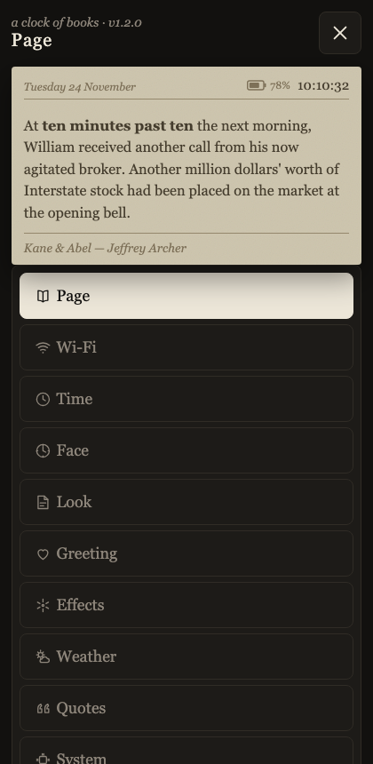

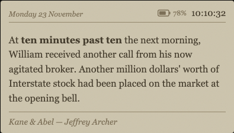

---

## 3. Features at a glance

| Area | What you can do |
|------|------------------|
| **Page** | See the current quote; **Sync time + TZ** quick button, **Blackout / Sleep now** (or **Wake screen**) button, turn the page, refresh, zen on phone or on clock; header shows **battery icon** when a sensor is present |
| **Wi‑Fi** | Scan, join a network, forget saved network, set optional Clock AP password (8–63 chars) |
| **Time** | Searchable **24-zone global list** (`UTC±HH · City`) + **Custom POSIX TZ** input, automatic DST rule synthesis from your browser, live clock-vs-browser drift readout, 3 browser sync buttons (`Sync time + TZ`, `Sync time only`, `Sync TZ only`), manual date/time, hardware RTC status, 12/24‑hour, page turn schedule, **Sleep / blackout mode** (`Off`, `Schedule`, or `Auto Sunset–Sunrise`) with today’s sun times + **Blackout now**, alarm |
| **Face** | Quote page or 7 clock faces (Classic, 1950, Flip, Digital, Split, Square, Nixie) and face options |
| **Look** | Paper palette, lamp/text/both brightness, type size (`Small`, `Medium`, `Large`, or **`Auto (fill screen)`** to maximize quote text without scrolling), typeface, **Night paper** (`Off`, `Auto 21–06`, `Auto Sunset–Sunrise`, `Always dark`), zen, **Screen rotation** (`0°` / `90°` / `180°` / `270°`) |
| **Greeting** | Words at power‑on (and optionally after sleep — editable from phone, panel Effects → Edit text, or Serial `greet`), lettering, colours, animations |
| **Effects** | Drifting snow, leaves, petals, fireflies, night sky, rain, hearts, balloons, fireworks, Christmas, or by season |
| **Weather** | Line under the date (Open‑Meteo, no API key, cached place lookup) plus Latitude / Longitude fields (auto-filled or manual offline for Sunrise / Sunset) |
| **Quotes** | Information only — the Literature collection lives directly in internal flash so updates ship as one OTA binary with no SD card required |
| **System** | Board name, IP, Wi‑Fi RSSI, firmware version, hardware **Clock RTC** status (`verified via NTP` / `RTC-first`), **Power mode**, **Rotation**, today’s sun times, **Battery** telemetry (`%`, `mV`, charging, sensor), **Setup wizard**, restart, **Factory reset** |
| **Update** | **Check for update** against GitHub (`v1.2.4`), install from an HTTP/HTTPS URL (`firmware/<board>/latest.txt` → `latest/firmware.bin`) or local `.bin` with an animated `0%–100%` on-screen progress bar, plus optional **Daily check (03:00)** (Off by default) |
| **Advanced** | **Power &amp; battery saver** (`Always on`, `Sleep Wi-Fi when idle`, `Auto on battery`, `Battery saver always`), **Offline mode**, export/import settings, I2C bus discovery (including RTC `0x51`/`0x68`, touch `0x5D`, CH422G `0x24`, INA219 `0x40`) |

**On the panel only (7″ & 4.3B):** full **Setup** grid + **More** panel (Typeface, Offline mode, Weather on/off/units/place, AP password, 03:00 auto-update, Setup wizard, Factory reset), brightness sliders, palette picker, on‑screen Wi‑Fi/text keyboard (`Effects → Edit text`, `More → Place / AP Pass`), **Alarm and sleep**, and **Effects** (with greeting font/color/size), plus multi-directional swipe and long-press touch gestures. All boards support full Web UI and Serial CLI parity (`bright`, `lamp`, `ink`, `typeface`, `faceopt`, `ambient`, `datetime`, `greet`, `ap pass`, `setup`, `factoryreset`).

---

## 4. Settings tabs (screenshots)

Each image is the **Save on the clock** section for that tab. Palette changes on **Look** also apply as soon as you pick a swatch.

### Page

See the live quote, tap **Sync time + TZ** for one-click UTC + timezone sync from your phone or computer, tap **Blackout / Sleep now** (or **Wake screen**) to blank or restore the display immediately, turn the page, refresh, send zen to the clock, or inspect the collapsible **Touch & swipe gestures** zone diagram (7″ & 4.3B). When a battery sensor is active, a live battery icon and percentage badge appear in the top bar.

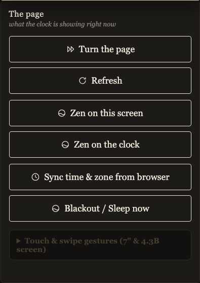

**Touch &amp; swipe gestures guide (Page tab):**

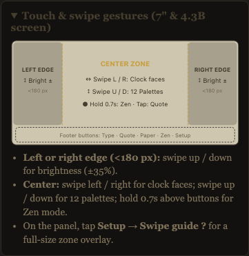

### Wi‑Fi

Scan for networks, enter password, join or forget, or set an optional WPA2 password (8–63 characters, or blank for open) for the `LiteratureClock` setup access point.

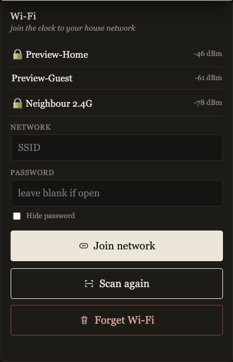

### Time

Choose from **24 global time zones** (`UTC−10` Hawaii to `UTC+12` Auckland) using the live **Filter time zones** search box (`UTC±HH · City`) or enter any **Custom POSIX TZ** string; view live **browser-vs-clock time comparison** with **Sync time + TZ**, **Sync time only**, and **Sync TZ only** buttons (with automatic DST rule synthesis for unlisted browser zones); set manual date/time inputs, clock schedule, **Sleep / blackout mode** (`Off`, `Schedule`, or `Auto Sunset–Sunrise`) with today’s calculated sunrise/sunset times and an instant **Blackout now** button, and alarm (screen pulses until you touch the panel).

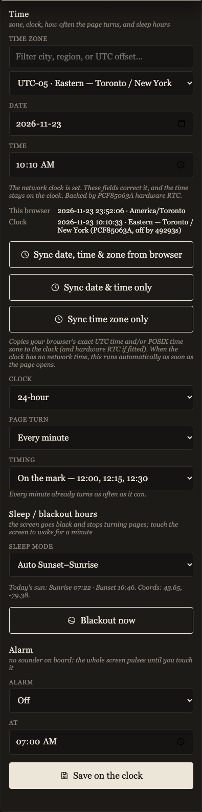

### Face

Choose the quote page or any of the 7 clock faces (**Classic**, **1950 rectangle**, **Flip** individual digit cards, **Digital**, **Split**, **Square 1970s retro**, and **Nixie tube**), plus options for seconds, date, digital time, weather on the face, hands, and colours. Square and Zen clock faces fill the screen cleanly in Zen mode.

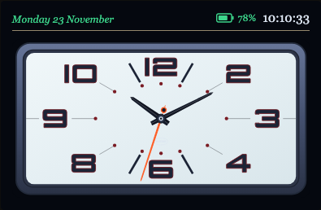

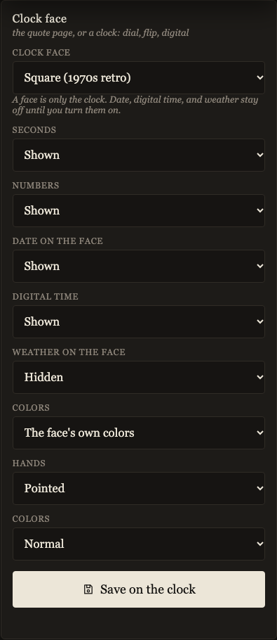

### Look

Palette, three brightness sliders, type, **Night paper** (`Off`, `Auto 21–06`, `Auto Sunset–Sunrise`, or `Always dark` — automatically dimming the backlight to `62%` while active) with today’s sun times, zen on the clock, and **Screen rotation** (`0°`, `90°` portrait CW, `180°` flipped, `270°` portrait CCW; also stepped in 90° increments directly in on-device Setup with full responsive `480×800` portrait layouts).

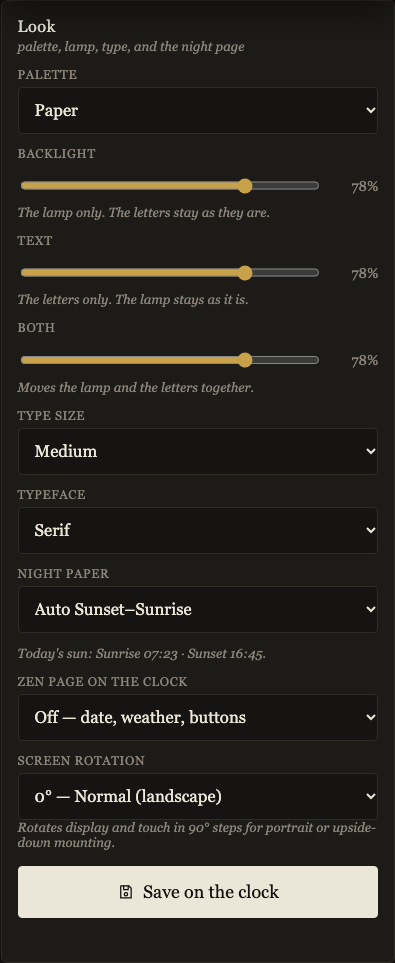

### Greeting

Start‑up message, optional greeting when sleep ends, pictures like `:heart:`, preview on the phone.

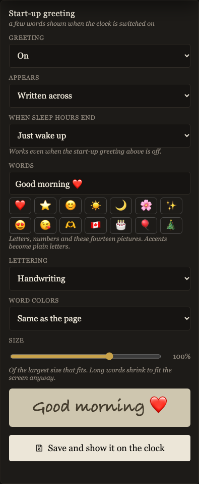

### Effects

What drifts over the page and faces; where and how many; zen and face toggles.

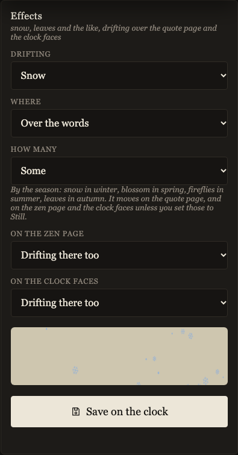

### Weather

On/off, °C/°F, place name for the forecast line, plus **Latitude** / **Longitude** (filled automatically when Weather geocodes a place, or entered manually offline for Sunrise / Sunset times).

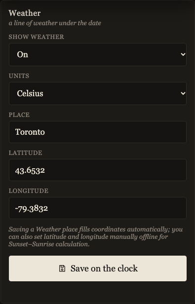

### Quotes

All onboard quotes are family‑friendly (filtered when the library is packed into firmware). Because the entire Literature library resides in internal flash, no SD card is required and software updates work cleanly over single-file Wi-Fi / GitHub OTA.

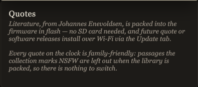

### System

Facts about this clock (board model, IP, Wi-Fi strength, **Clock RTC** chip with NTP verification state, active **Power mode**, **Rotation**, today’s **Sun** sunrise/sunset, **Screen** awake/blackout &amp; Night paper status, **Battery** status when present); **Restart clock**.

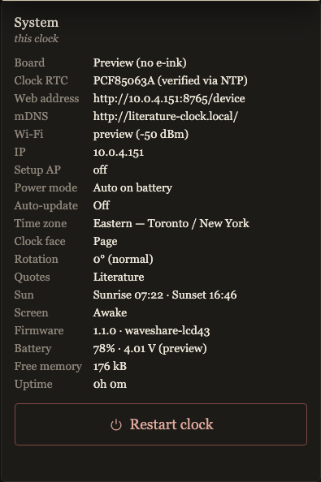

### Update

Tap **Check for update** to compare your running version (also shown in the Web UI header bar, Setup header, and Serial `help`) against `https://github.com/markusvankempen/literature-clock`, upload a local `firmware.bin`, or tap **Install from address** (`firmware/<board>/latest.txt` → `latest/firmware.bin`). During installation the clock displays an animated `0%–100%` progress bar (also reachable directly from **Setup → Check update** on the display or `checkupdate` / `update` over Serial). Optionally enable **Daily check (03:00)** (Off by default) for automatic overnight checks when Wi‑Fi is connected (skipped when offline or in Battery saver).

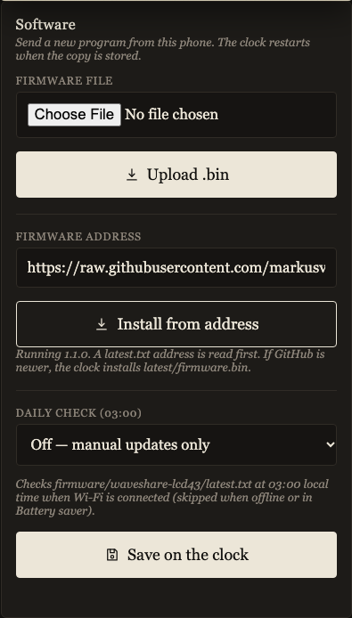

### Advanced

Choose **Power &amp; battery saver** (`Always on`, `Sleep Wi-Fi when idle`, `Auto on battery`, or `Battery saver always`) with live status feedback, **Export settings** / **Import settings** JSON backup, and **Discover I2C devices** (reports real chips on `GPIO 8/9` such as GT911 touch `0x5D`, CH422G `0x24`, RTC `0x51`/`0x68`, or `INA219` `0x40`).

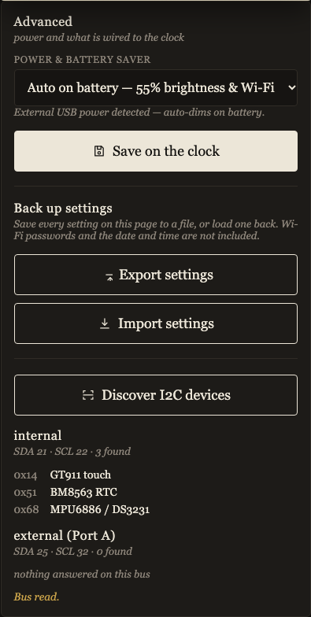

---

## 5. Saving changes

- Most tabs: tap **Save on the clock** after editing (firmware only writes changed NVS keys to minimise flash wear).
- **Time tab:** tapping **Save on the clock** preserves the clock’s running time unless you explicitly edit the date/time boxes or press one of the browser **Sync** buttons.
- **Palette (Look):** saves automatically when you choose a swatch.
- **Export/import (Advanced):** backup saves every setting the phone controls; Wi‑Fi passwords and date/time are not included in the file.

---

## 6. Factory defaults (7″ & 4.3B Waveshare)

These apply after a fresh flash or before you change anything. Values are stored in the clock’s flash and survive power loss.

### Time, page, and clock

| Setting | Default |
|---------|---------|
| Time zone | US Eastern (`EST5EDT`) |
| 12 / 24‑hour clock | 24‑hour |
| Page turn | Every **1** minute |
| Timing | **On the mark** (not random within the window) |
| Show date and time on quote page | On |
| Show citation line | On |

### Look

| Setting | Default |
|---------|---------|
| Paper palette | **Midnight** (dark paper) |
| Lamp / text / both | **80** (lamp and text levels match on first run) |
| Type size | **Medium** *(supports `Small`, `Medium`, `Large`, and `Auto (fill screen)`)* |
| Typeface | **Serif** |
| Night paper | **Off** |
| Screen rotation | **0°** *(supports `0°`, `90°` portrait CW, `180°` flipped, `270°` portrait CCW)* |
| Zen page on clock | **Off** |

### Clock face

| Setting | Default |
|---------|---------|
| Face | **Page** (quote, not a dial) |
| Seconds on face | Off |
| Numbers on face | On |
| Date / digital time / weather on face | Off |
| Minute marks | On |
| Split / 1950 colours | White & blue halves, sky‑blue accents, dark numbers (when those faces are used) |

### Greeting

| Setting | Default |
|---------|---------|
| Greeting at start‑up | **Off** |
| Greeting when sleep ends | **Off** |
| Words | *(empty)* |
| Lettering | Handwriting |
| How it appears | Written across |
| Size | 100% |
| Word colours | Page ink |

### Effects (falling things)

| Setting | Default |
|---------|---------|
| Drifting | **None** |
| Where | Over the words |
| How many | Some |
| On zen page | **On** (when an effect is chosen) |
| On clock faces | **On** (when an effect is chosen) |

### Sleep and alarm

| Setting | Default |
|---------|---------|
| Sleep / blackout mode | **Off** *(supports `Schedule` or `Auto Sunset–Sunrise` + instant `Blackout now`)* |
| Sleep from / until | 23:00 – 07:00 *(used when scheduled sleep is selected)* |
| Alarm | **Off** |
| Alarm time | 07:00 *(used when alarm is on)* |

### Weather and network

| Setting | Default |
|---------|---------|
| Weather line | **On** |
| Place | **Halifax** |
| Latitude / Longitude | `44.6488, -63.5752` *(auto-updated from Weather place or timezone default)* |
| Units | **Metric (°C)** |
| Power &amp; battery saver | **Always on** *(supports `Always on`, `Sleep Wi-Fi when idle`, `Auto on battery`, `Battery saver always`)* |
| Offline mode | **Off** |
| Daily auto‑update (03:00) | **Off** *(opt-in on **Update** tab or `autoupdate on`; skipped when offline or in Battery saver)* |

### Quotes

| Setting | Default |
|---------|---------|
| Source | **Literature** (Johannes Enevoldsen collection, on the clock) |

---

## 7. Smaller boards (2.8″ CYD, M5Paper)

The **same phone page** works, and both smaller boards support **Auto-Night Paper** (including `Sunset–Sunrise`) and **Blackout / Sleep Mode** with touch-to-wake (PWM `0` + black framebuffer on 2.8″ CYD; dark sleeping notice on M5Paper). M5Paper also includes onboard **BM8563 RTC**, **M5Power battery indicator** telemetry, and the Setup **Sun** night-paper chip out of the box, while panels on these smaller boards show a simpler setup and omit 7″/4.3B extras (faces, greeting, effects, swipe gestures, on‑screen Wi‑Fi keyboard). Defaults for **palette** and **brightness** use **Paper** and **140** instead of Midnight / 80.

---

## 8. Quick tips & touch gestures

### Touch gestures (Waveshare 7″ & 4.3B)

- **On-screen guides & hints:** Open **Setup → Swipe guide ?** on the clock (or view the **Touch & swipe gestures** card on the phone **Page** tab) for a visual zone map. Subtle grip marks hug the left/right edges on the quote page, panels show relevant swipe tips, tapping a clock face shows a gesture strip above the buttons, and each gesture flashes a short toast (plus a 5-second startup summary).
- **Tap** the quote on the clock for another line for the same minute (or tap a clock face to show/hide buttons, or tap in Zen mode to leave).
- **Swipe left or right** anywhere on the quote page, clock face, or Zen page to step to the next or previous clock face.
- **Swipe up or down in the centre** to cycle through the 12 paper palettes (works on the quote page, clock faces, and Zen mode).
- **Swipe up or down near the left or right edge** (outer 180 px) to increase or decrease the **backlight and ink brightness** (`±35`).
- **Long‑press (~0.7 s+)** above the bottom buttons to enter **Zen mode** directly.

### Hardware, battery & recovery

- **Hardware RTC first (4.3B, M5Paper & external modules):** the 4.3B’s onboard `PCF85063A`, M5Paper’s `BM8563`, or an external `PCF85063A`/`DS3231` is the primary clock. When Wi‑Fi connects, the clock verifies the hardware RTC against NTP **once** and stops SNTP, keeping time from the RTC (with hourly re-sync and flash-only checkpoints).
- **Battery saver & power modes:** choose **Always on**, **Sleep Wi‑Fi when idle** (120 s), **Auto on battery** (triggers on M5Power PMIC / INA219 / ADC discharge and restores automatically when USB/charging returns), or **Battery saver always** (for stock Waveshare panels on LiPo without a gauge). Battery saver scales brightness/ink to **55%**, pauses ambient particles and weather fetches, puts Wi‑Fi to sleep after **45 s** of web inactivity (without waking Wi‑Fi for onboard quote turns), and skips boot Wi‑Fi whenever a valid hardware RTC is present. Change it in **Web UI → Advanced**, **Setup → Brightness** (top-right chip on 7″/4.3B), **Setup → Wi‑Fi** (`Power` chip on M5Paper), or `power 0..3` over serial.
- **Battery indicator:** appears in the screen header and web UI automatically when an `M5Power` PMIC, Waveshare `INA219` (`0x40`), or opt-in ADC divider build is present (`0x36` is reserved by the Waveshare CH422G expander).
- **Sleep / blackout mode:** chooses **Off**, **Schedule (`From`–`Until`)**, or **Auto Sunset–Sunrise** — switches off the backlight and clears the screen to pure black with no page turns (or tap **Blackout now** for instant sleep); **touch the glass** to wake for one minute (or exit manual blackout).
- **Alarm:** no sound — the whole screen **pulses** until you touch it.
- **Hold BOOT** at power‑on (~2.5 s) to clear saved Wi‑Fi (7″ & 4.3B panels).
- **Serial** (USB, 115200 baud): type `help` for commands (`status`, `i2c`, `power`, `rotate`, `font`, `face`, `greet`, `ap pass`, `setup`, `factoryreset confirm`, `autoupdate`, `checkupdate`, `update`, `panel`, `bl`, etc.). On Waveshare 7″ use either the **UART** USB-C port or native **USB** (`USB_CDC_ON_BOOT=1`); on 4.3B use the **native USB-C** port.
- **Automated live verification &amp; docs screenshots:** run `python3 scripts/test_device_live.py` to test HTTP `/api/*` + Serial CLI end-to-end on connected hardware (and `node scripts/capture_manual_screenshots.mjs` to refresh manual screenshots from `include/web_app_html.h`). Prebuilt releases publish to [markusvankempen/literature-clock](https://github.com/markusvankempen/literature-clock).

---

## Credits

Quotes: [Johannes Enevoldsen](https://github.com/JohsEnevoldsen/literature-clock) (CC BY‑NC‑SA 2.5). Firmware: [Markus van Kempen](https://markusvankempen.github.io/).

*No bug too small, no syntax too weird.*

---

## Author Markus van Kempen

[Research | Floor 7½ 🏢🤏](https://markusvankempen.github.io/)

No bug too small, no syntax too weird.
